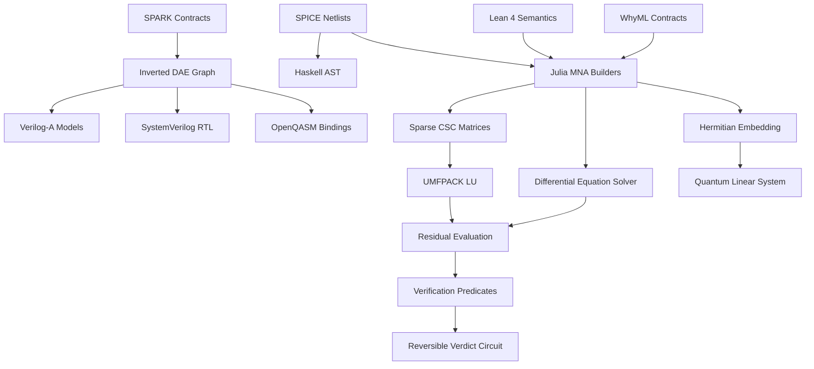
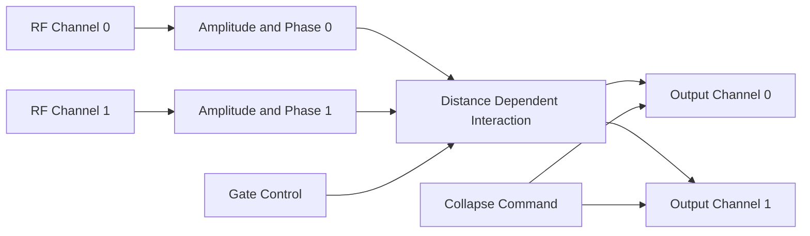
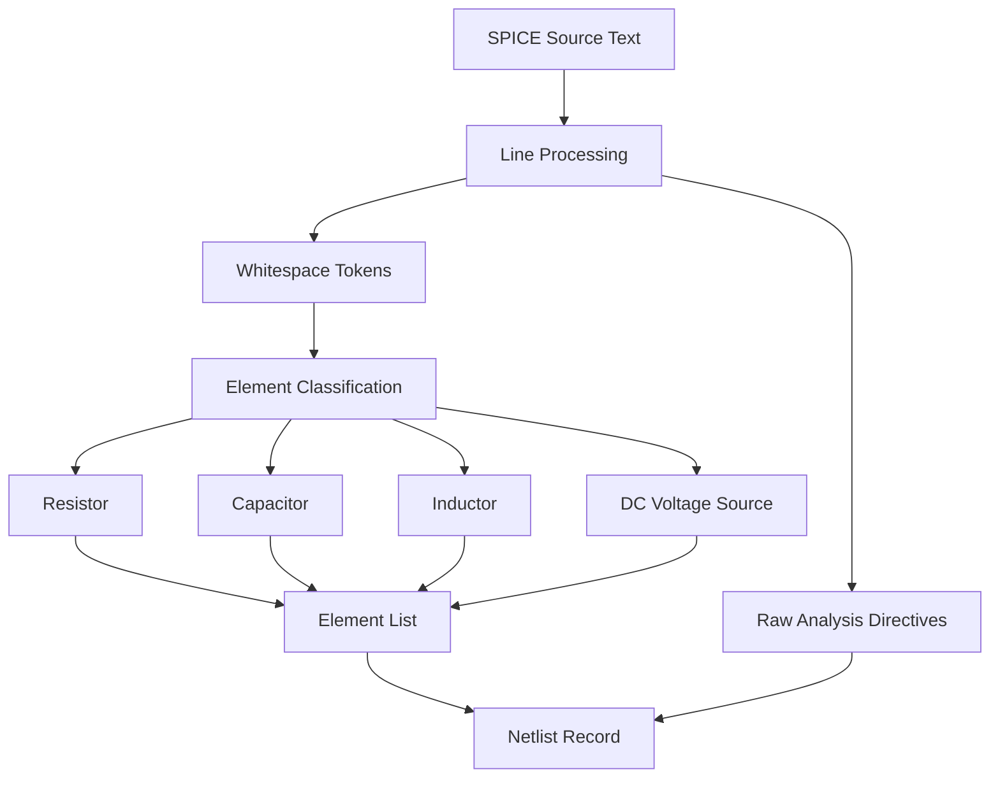
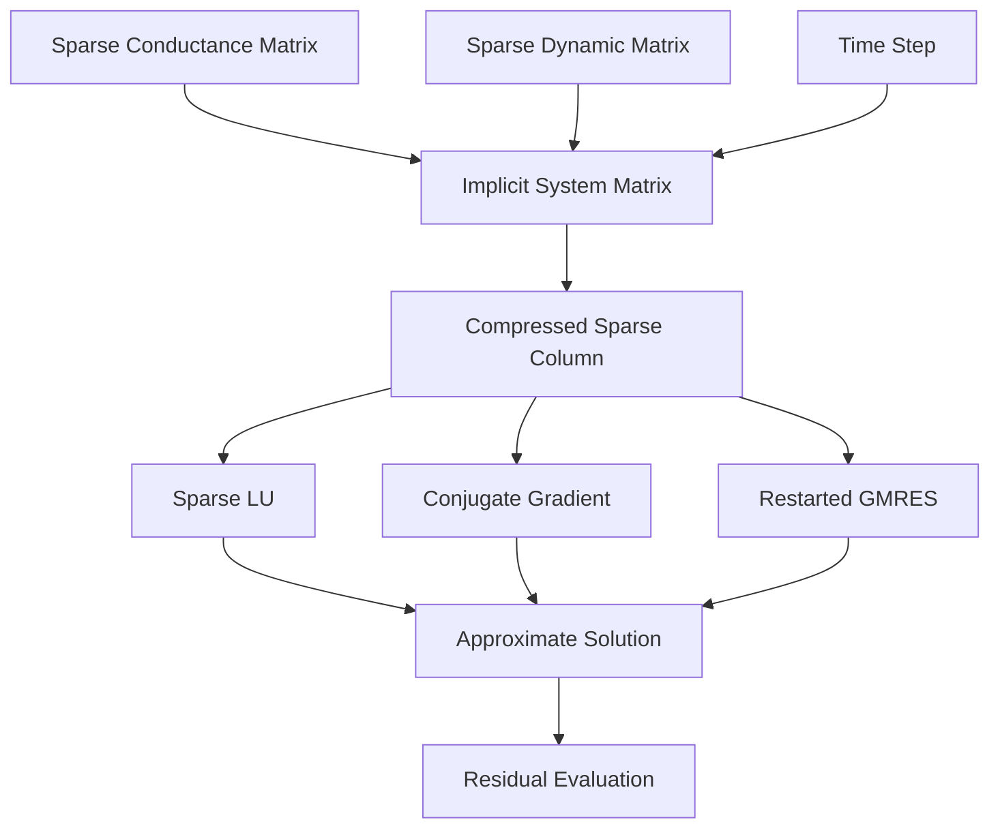
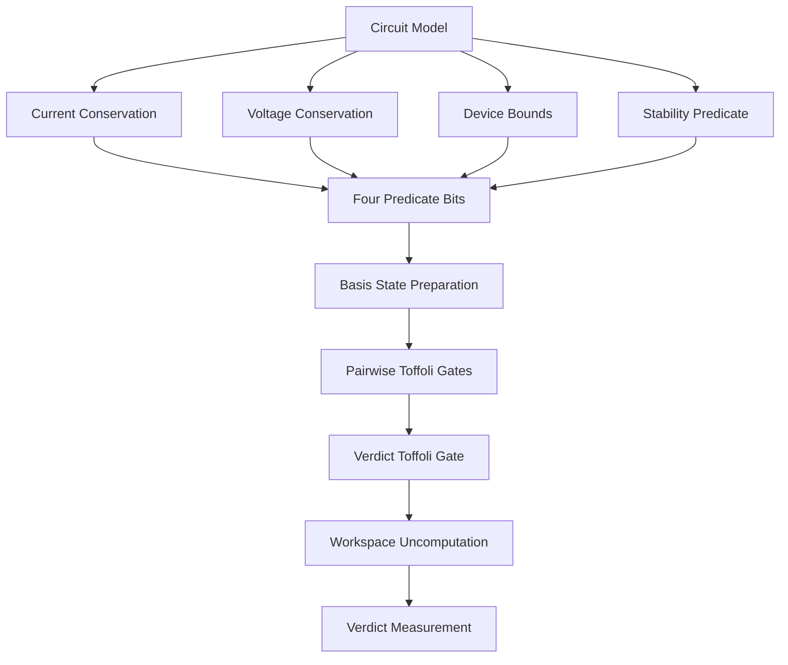
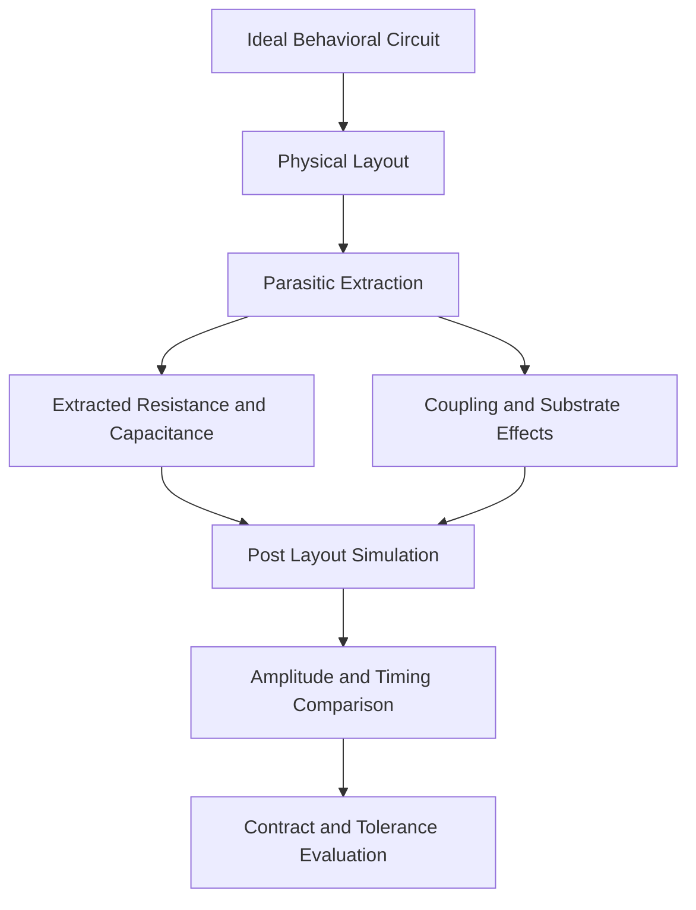

# NANO-GROVER // SOVEREIGN CIRCUIT FABRIC

```
╔══════════════════════════════════════════════════════════════╗
║  ANALOG QUANTUM  ·  FORMAL INVERSION  ·  SPARSE SILICON      ║
║  SPARK → DAE → MNA → UMFPACK → OpenQASM                      ║
╚══════════════════════════════════════════════════════════════╝
```

Dark-panel instrument stack: continuous-time Grover diffusion, φ-braid
processors, SPARK contracts inverted into DAEs, sparse UMFPACK solves,
and OpenQASM verification backends.

---

## Cross-Domain Map

| SPARK Contract | Verilog-A | Transistor |
|----------------|-----------|------------|
| Bounded Integer | Voltage Rails | Supply clamping |
| State Invariant | Steady-state nodal balance | Collector/drain equilibrium |
| Matrix Multiplier | VCVS / Gilbert cell | Translinear loop |
| Hash Integrity | Non-linear mixing | Exponential mixer |

Inversion principle:

$$
\{\mathrm{Pre}(S)\}\;\mathrm{Cmd}\;\{\mathrm{Post}(S,S')\}
\quad\longmapsto\quad
E(x)\,\dot x + f(x,t) = 0
$$

Pre → initial charge. Post → voltage attractor. Assert-fail → rail clamp.

---

## Analog Core (Verilog-A)

**Nano-Grover DAE** — basis voltages $V_k(t)\in\mathbb{R}^{N}$, $N=2^n$:

$$
C\,\dot{\mathbf V}
= \mathbf I_L + \mathbf I_{\mathrm{NDR}}(\mathbf V)
+ G_m(\bar V\,\mathbf 1 - \mathbf V)
+ O(\varepsilon^2)\,\mathbf V
$$

$$
L\,\dot{\mathbf I}_L = -\mathbf V,
\qquad
\bar V = N^{-1}\sum_k V_k
$$

Oracle $U_\omega$: cubic NDR on target branch (phase $\pi$).
Diffusion $U_s = 2|s\rangle\langle s|-I$: reflection across $\bar V$ in window
$\Delta t = \pi/(2\omega_0)$.

**Energy / amplification theorem**

$$
\|\mathbf V(t)\|_2^2 = V_0^2 + O(\varepsilon^2)
$$

$$
k = \Big\lfloor\tfrac{\pi}{4}\sqrt N\Big\rfloor
\implies
\frac{|V_\omega(k\Delta t)|^2}{V_0^2}\ge 1-\frac1N
$$

| Module | Role |
|--------|------|
| `src/nano_grover_core.va` | Parameterized $N\ge 8$ LC/NDR core |
| `src/nano_grover_triple_iteration.va` | 2-qubit ×3 iterate + collapse |
| `src/spatial_grover_lattice.va` | Microwave / cross-resonance lattice |
| `src/trig_braid_processor.va` | $\varphi$-weighted $\rho(\sigma_1)$ |
| `src/trig_processor.va` | $\sin/\cos$ + rail checks |
| `src/braid_trig_processor.va` | Minimal Metatron $\varphi$ core |

Braid outputs:

$$
\begin{aligned}
S &= \tfrac{\varphi}{2}\sin\theta + \tfrac12\cos\theta\\
C &= \tfrac12\sin\theta - \tfrac{\varphi}{2}\cos\theta
\end{aligned}
\qquad\varphi/2 \approx 0.809017
$$

---

## Digital / Quantum RTL

| Module | Role |
|--------|------|
| `rtl/braid_chord_flop_rom.sv` | Flop ROM — chord eigenvalues (200 / 280 / 351 Hz) |
| `rtl/trig_*.sv` | Digital duals of braid / trig processors |
| `rtl/quantum/q_braid_chord_rom.sv` | Amplitude-encoded 2-qubit look-up |
| `rtl/quantum/q_grover_flop_stage.sv` | Oracle sign-flip + diffusion in IEEE-754 flops |

---

## SPARK Contracts

```
spark/nano_grover_contracts  — Voltage_Rail, Oracle_Flip, Diffusion, Braid_Multiply
spark/braid_chord_contracts  — Chord_Lookup ↔ flop ROM words
```

## Inverted DAE Graph

`graph/dae_inverted_graph.xml` v1.1 — layered tree:

1. Parameters → 2. Rails → 3. Contracts → 4. StateVariables →
5. AlgebraicVariables → 6. Dynamics ($\mathrm{ddt}/\mathrm{idt}/\mathrm{KCL}/\mathrm{map}/\mathrm{clamp}$) →
7. CrossDomain → 8. SemiconductorBounds

Each contract carries explicit
$\mathrm{PreMapsTo}$, $\mathrm{PostMapsTo}$, $\mathrm{AssertFailMapsTo}$.

---

## Analog OpenQASM ↔ HDL

| Circuit | HDL bind | Contract |
|---------|----------|----------|
| `analog_grover_2q.qasm` | `nano_grover_triple_iteration.va` | Oracle, Diffusion |
| `analog_braid_trig.qasm` | `trig_braid_processor.va/.sv` | Braid |
| `analog_spatial_lattice.qasm` | `spatial_grover_lattice.va` | CR / collapse |
| `analog_q_grover_flop.qasm` | `q_grover_flop_stage.sv` | Flop Grover |

Pragma protocol: `nano_grover.map` · `nano_grover.bind`.

---

## SPICE → MNA → UMFPACK → OpenQASM

**Linear circuit law**

$$
C\dot x + Gx = b(t)
$$

**Backward Euler**

$$
\Bigl(G+\frac{C}{\Delta t}\Bigr)x_{k+1}
= b_{k+1}+\frac{C}{\Delta t}x_k
\quad\equiv\quad Ax=b
$$

**Hermitian embedding** (quantum LSQ path)

$$
H = \begin{bmatrix} 0 & A \\ A^\dagger & 0 \end{bmatrix}
$$

**Residual observable**

$$
\mathcal L(x) = \|Ax-b\|_2^2
$$

**Refinement**

$$
\mathrm{Accept}_{\mathrm{QASM}}(N)\;\Longrightarrow\;\mathrm{Valid}_\varepsilon(N)
$$

### Solver stack

| Layer | Path | Role |
|-------|------|------|
| Lean stamps | `semantics/MNAStamping.lean` | $G$/$C$/$L$/$V$ stamps + residual energy |
| WhyML | `contracts/stamps.mlw` | Pre/Post on stamp mutations |
| Dense DE | `numerical/DiffEq.jl` | Euler / BE / trapezoidal integration |
| Sparse | `numerical/SparseSolver.jl` | CSC stamps, CG, GMRES |
| **UMFPACK** | `numerical/UMFPACK.jl` | Cached LU, BE step, DC, rcond |
| Quantum | `quantum/predicates.qasm` | Reversible 4-predicate AND |
| Quantum | `quantum/linear_system.qasm` | Embedded $H$ residual sample |

UMFPACK path:

$$
A = G + C/\Delta t
\xrightarrow{\mathrm{lu}}
LU
\xrightarrow{\backslash}
x,
\qquad
\|Ax-b\|_2 < \varepsilon
$$

---

## Lean Markov Verification

`lean/NanoGroverMarkov.lean` — zero-dependency Markov chain on
$S = \mathrm{Fin}\,N \times \mathrm{Bool}$:

$$
P^{(t+1)}(x,z)=\sum_y P^{(t)}(x,y)\,P(y,z)
$$

Theorems: row-stochastic invariant · amplitude amplification
$p_\omega^{(t^*)}\ge 1-1/N$ · Verilog↔Markov bisimulation.

---

## Semiconductor Bounds

$$
V_T\approx 25.85\,\mathrm{mV},
\quad
f_T\ \mathrm{latency\ ceiling},
\quad
v_{\mathrm{sat}}\ \mathrm{FinFET\ braid\ limit}
$$

Weak/strong inversion kept; subthreshold leakage isolated from charge packets.


---

## Engineering Architecture



| Domain | Representation | Computational Responsibility |
|---|---|---|
| Analog | Verilog-A | Continuous-time electrical dynamics |
| Digital | SystemVerilog | Registered amplitude representation |
| Formal | SPARK | Preconditions and postconditions |
| Mathematical | Lean 4 | Discrete semantics and theorem statements |
| Deductive | WhyML | Matrix mutation contracts |
| Numerical | Julia | Differential equations and matrix construction |
| Sparse | UMFPACK | Sparse LU factorization |
| Quantum | OpenQASM 3 | Gate operations and predicate aggregation |
| Structural | XML | Cross-domain traceability |
| Parsing | Haskell | Abstract SPICE element representation |

---

## Complete Repository Structure

```text
nano-grover-diffusion-oracle/
├── LICENSE
├── LICENSES/
│   └── LicenseRef-Sovereign-Leviathan-SL-AGPL3-001.txt
├── README.md
├── docs/
│   ├── CIRCUIT_THEOREM.md
│   ├── CROSS_DOMAIN_MAPPING.md
│   └── SPARK_TO_DAE_INVERSION.md
├── graph/
│   └── dae_inverted_graph.xml
├── lean/
│   └── NanoGroverMarkov.lean
├── openqasm/
│   ├── analog_braid_trig.qasm
│   ├── analog_grover_2q.qasm
│   ├── analog_q_grover_flop.qasm
│   ├── analog_spatial_lattice.qasm
│   └── bindings/
│       └── hdl_bind_table.md
├── rtl/
│   ├── braid_chord_flop_rom.sv
│   ├── braid_trig_processor.sv
│   ├── trig_braid_processor.sv
│   ├── trig_processor.sv
│   └── quantum/
│       ├── q_braid_chord_rom.sv
│       └── q_grover_flop_stage.sv
├── spark/
│   ├── braid_chord_contracts.ads
│   ├── braid_chord_contracts.adb
│   ├── nano_grover_contracts.ads
│   └── nano_grover_contracts.adb
├── spice-qasm-verifier/
│   ├── README.md
│   ├── calibration/
│   │   └── control_pulses.qasm
│   ├── contracts/
│   │   ├── discretization.mlw
│   │   └── stamps.mlw
│   ├── netlists/
│   │   ├── mosfet.cir
│   │   ├── rc.cir
│   │   └── rlc.cir
│   ├── numerical/
│   │   ├── DiffEq.jl
│   │   ├── Hermitian.jl
│   │   ├── MNA.jl
│   │   ├── README_SPARSE.md
│   │   ├── Residual.jl
│   │   ├── SparseSolver.jl
│   │   └── UMFPACK.jl
│   ├── parser/
│   │   └── SpiceNetlist.hs
│   ├── quantum/
│   │   ├── linear_system.qasm
│   │   └── predicates.qasm
│   ├── semantics/
│   │   ├── DeviceModels.lean
│   │   ├── Kirchhoff.lean
│   │   ├── MNA.lean
│   │   ├── MNAStamping.lean
│   │   └── Stability.lean
│   ├── tests/
│   │   ├── mna_stamp_rc.jl
│   │   ├── mna_stamp_rlc.jl
│   │   ├── rc_smoke.md
│   │   ├── sparse_solver_smoke.jl
│   │   └── umfpack_stack_smoke.jl
│   └── verification/
│       ├── ErrorBounds.lean
│       └── Refinement.lean
└── src/
    ├── braid_trig_processor.va
    ├── nano_grover_core.va
    ├── nano_grover_triple_iteration.va
    ├── spatial_grover_lattice.va
    ├── trig_braid_processor.va
    └── trig_processor.va
```

---

## Mathematical Foundations

### State Representation

The ideal computational state is an N-dimensional
amplitude vector, where N = 2ⁿ.

$$
s=\frac{1}{\sqrt{N}}(1,\ldots,1)^T
$$

For an electrical representation, a nonzero voltage
vector can be projected onto the normalized amplitude space.

$$
a=\frac{V}{\|V\|_2}
$$

The physical circuit additionally contains branch currents,
stored energy, device constraints, and continuous-time
dynamics.

### Oracle Operator

For a marked basis index ω:

$$
O_\omega=I-2e_\omega e_\omega^T
$$

The oracle reverses the marked amplitude while preserving
the other components.

### Diffusion Operator

$$
D=2ss^T-I
$$

Each amplitude is reflected about the ensemble mean.

$$
\mu=\frac{1}{N}\sum_{i=0}^{N-1}a_i
$$

$$
a_i'=2\mu-a_i
$$

### Grover Iteration

$$
G=DO_\omega
$$

The ideal operator preserves the squared norm.

$$
G^TG=I
$$

$$
\|Ga\|_2^2=\|a\|_2^2
$$

### Amplitude Amplification

$$
\theta=\arcsin\left(\frac{1}{\sqrt{N}}\right)
$$

$$
p_\omega(k)=\sin^2((2k+1)\theta)
$$

| Basis States | Index Bits | Approximate Optimal Iterations |
|---:|---:|---:|
| 4 | 2 | 1 |
| 8 | 3 | 2 |
| 16 | 4 | 3 |
| 64 | 6 | 6 |
| 256 | 8 | 12 |
| 1024 | 10 | 25 |
| 4096 | 12 | 50 |
| 65536 | 16 | 201 |

These iteration counts describe the ideal search model.
Physical settling time and circuit resource consumption
require separate evaluation.

### Two-Qubit Analytic Reference

Target basis state: 11.

| Stage | 00 | 01 | 10 | 11 | Target Probability |
|---|---:|---:|---:|---:|---:|
| Preparation | 0.5 | 0.5 | 0.5 | 0.5 | 0.25 |
| Oracle | 0.5 | 0.5 | 0.5 | -0.5 | 0.25 |
| Reflection | 0 | 0 | 0 | 1 | 1 |
| Iteration 2 | -0.5 | -0.5 | -0.5 | 0.5 | 0.25 |
| Iteration 3 | -0.5 | -0.5 | -0.5 | -0.5 | 0.25 |

```text
INITIAL STATE

00  █████░░░░░  0.25
01  █████░░░░░  0.25
10  █████░░░░░  0.25
11  █████░░░░░  0.25

IDEAL FIRST GROVER ITERATION

00  ░░░░░░░░░░  0.00
01  ░░░░░░░░░░  0.00
10  ░░░░░░░░░░  0.00
11  ██████████  1.00
```

---

## Continuous-Time Circuit Architecture

Source: [`src/nano_grover_core.va`](src/nano_grover_core.va)

```text
                  PHASE CONTROLLER
                         │
               ┌─────────┴─────────┐
               │                   │
          ORACLE WINDOW       DIFFUSION WINDOW
               │                   │
               ▼                   ▼
          TARGET NDR         MEAN FEEDBACK
               │                   │
     ┌─────────┴───────────────────┴─────────┐
     │                                       │
     │        BASIS VOLTAGE NETWORK          │
     │                                       │
     │   V₀    V₁    V₂    V₃   ...   Vₙ    │
     │    │     │     │     │          │    │
     │   LC    LC    LC    LC         LC    │
     │    │     │     │     │          │    │
     └────┴─────┴─────┴─────┴──────────┴────┘
                         │
                         ▼
                   ENSEMBLE MEAN
```

### Physical Parameters

| Parameter | Default | Unit | Function |
|---|---:|---|---|
| N | 8 | count | Basis voltage channels |
| omega | 0 | index | Marked basis state |
| V0 | 1.0 | V | Amplitude scale |
| omega0 | 1e9 | rad/s | Timing frequency |
| Cnode | 1e-12 | F | Node capacitance |
| Lnode | 1e-9 | H | Branch inductance |
| Gm | 1e-3 | S | Feedback transconductance |
| Rndr | 1000 | Ω | NDR characteristic resistance |
| eps | 1e-6 | dimensionless | Parasitic coefficient |

### LC Dynamics

$$
I_C=C\frac{dV}{dt}
$$

$$
V_L=L\frac{dI}{dt}
$$

$$
\omega_{LC}=\frac{1}{\sqrt{LC}}
$$

$$
E=\frac{1}{2}CV^2+\frac{1}{2}LI^2
$$

The default LC values imply an ideal natural angular
frequency of approximately 3.1623 × 10¹⁰ rad/s.
The independent omega0 timing parameter determines
the declared quarter-cycle control window.

Correspondence between these frequencies is a calibration
condition for the physical implementation.

### Negative Differential Resistance

The target branch incorporates a cubic current law.

$$
I_{\mathrm{NDR}}(V)=
\frac{1}{R_{\mathrm{ndr}}}
\left(
-\frac{3}{2}V+
\frac{V^3}{2V_0^2}
\right)
$$

Its differential conductance is

$$
g_{\mathrm{NDR}}(V)=
\frac{1}{R_{\mathrm{ndr}}}
\left(
-\frac{3}{2}+
\frac{3V^2}{2V_0^2}
\right)
$$

The negative differential conductance region provides
an active nonlinear mechanism whose stability depends
on the surrounding circuit and operating point.

### Ensemble Mean Feedback

$$
\bar V=\frac{1}{N}\sum_i V_i
$$

$$
I_i=G_m(\bar V-V_i)
$$

The ensemble feedback stage couples each voltage
channel to the aggregate state.

### Energy Accounting

For N resonator branches:

$$
E(t)=
\sum_{i=0}^{N-1}
\left(
\frac{1}{2}C_iV_i^2+
\frac{1}{2}L_iI_i^2
\right)
$$

The electrical energy model includes both capacitor
and inductor contributions. Comparing voltage norm
against ideal amplitude conservation requires a
specified sampling surface and accounting for active
device energy injection and dissipation.

---

## Spatial Grover Lattice

Source: [`src/spatial_grover_lattice.va`](src/spatial_grover_lattice.va)



| Parameter | Default |
|---|---:|
| DISTANCE | 50 µm |
| COUPLING_K | 0.001 |
| VTH | 0.5 V |
| TR | 100 ps |

The implemented behavioral coupling follows

$$
J(d)=\frac{K}{d^3}
$$

The model maintains independent amplitude and phase
variables for its two channels. A physical
cross-resonance comparison requires a calibrated
interaction Hamiltonian and joint-state semantics.

---

## Golden-Ratio Braid Algebra

$$
\varphi=\frac{1+\sqrt{5}}{2}
$$

$$
\varphi^2=\varphi+1
$$

The trigonometric transformation uses

$$
B=\frac{1}{2}
\begin{bmatrix}
\varphi & 1\\
1 & -\varphi
\end{bmatrix}
$$

$$
B^TB=\frac{\varphi^2+1}{4}I
$$

A normalized version of this matrix is

$$
\widehat B=
\frac{1}{\sqrt{\varphi^2+1}}
\begin{bmatrix}
\varphi & 1\\
1 & -\varphi
\end{bmatrix}
$$

$$
\widehat B^T\widehat B=I
$$

| Analog Source | Digital Companion |
|---|---|
| `src/trig_processor.va` | `rtl/trig_processor.sv` |
| `src/trig_braid_processor.va` | `rtl/trig_braid_processor.sv` |
| `src/braid_trig_processor.va` | `rtl/braid_trig_processor.sv` |

Normalization distinguishes the raw analog gain
transformation from its orthogonal mathematical
counterpart.

---

## Digital Register Architecture

Source: [`rtl/quantum/q_grover_flop_stage.sv`](rtl/quantum/q_grover_flop_stage.sv)

```text
              TARGET SELECT [1:0]
                       │
                       ▼
               ┌──────────────┐
               │ SIGN CONTROL │
               └──────┬───────┘
                      │
   ┌──────────────────┼──────────────────┐
   │          │       │        │         │
   ▼          ▼       ▼        ▼         │
┌──────┐  ┌──────┐ ┌──────┐ ┌──────┐     │
│ A₀   │  │ A₁   │ │ A₂   │ │ A₃   │     │
│32-bit│  │32-bit│ │32-bit│ │32-bit│     │
└──┬───┘  └──┬───┘ └──┬───┘ └──┬───┘     │
   │         │        │        │          │
   └─────────┴────────┴────────┘          │
                      │                   │
                 OUTPUT VECTOR       VALID_OUT
```

### Interface

| Port | Width | Direction |
|---|---:|---|
| clk | 1 | Input |
| rst_n | 1 | Input |
| iterate_en | 1 | Input |
| target | 2 | Input |
| amp_in_0 | 32 | Input |
| amp_in_1 | 32 | Input |
| amp_in_2 | 32 | Input |
| amp_in_3 | 32 | Input |
| amp_out_0 | 32 | Output |
| amp_out_1 | 32 | Output |
| amp_out_2 | 32 | Output |
| amp_out_3 | 32 | Output |
| valid_out | 1 | Output |

### IEEE-754 Binary32

```text
31       30                23 22                      0
┌────────┬───────────────────┬────────────────────────┐
│ SIGN   │     EXPONENT      │       FRACTION         │
└────────┴───────────────────┴────────────────────────┘
  1 bit          8 bits                 23 bits
```

| Value | Hexadecimal Representation |
|---:|---|
| 0.0 | 00000000 |
| 0.5 | 3F000000 |
| -0.5 | BF000000 |
| 1.0 | 3F800000 |
| -1.0 | BF800000 |

The reset branch initializes all four amplitude
registers to 0.5. The qualifying clock event
inverts the selected amplitude sign bit.

The mean-reflection arithmetic is described in the
source as a downstream floating-point integration
operation. A complete RTL Grover correspondence
requires that arithmetic and its rounding behavior
to be incorporated into the clocked transition.

---

## SPARK Contract Traceability

| Contract Symbol | Mathematical Responsibility |
|---|---|
| Amplitude_Index | Four-element basis indexing |
| Voltage_Rail | Voltage interval from 0 to 1.8 V |
| Amplitude_Vector | Discrete amplitude representation |
| Norm_Sq | Nonnegative squared norm |
| Grover_Oracle_Flip | Marked amplitude inversion |
| Grover_Diffusion | Diffusion post-state constraints |
| Braid_Matrix_Multiply | Trigonometric transformation |
| Mix_Integrity | Bounded nonlinear mixing |
| Thermal_Voltage_mV | Thermal reference constant |
| Max_Transit_Freq | Illustrative frequency bound |

Source:

- [`spark/nano_grover_contracts.ads`](spark/nano_grover_contracts.ads)
- [`spark/nano_grover_contracts.adb`](spark/nano_grover_contracts.adb)
- [`spark/braid_chord_contracts.ads`](spark/braid_chord_contracts.ads)
- [`spark/braid_chord_contracts.adb`](spark/braid_chord_contracts.adb)

### Voltage Encoding

Signed mathematical amplitudes can be represented
inside a unipolar supply interval through an affine
encoding.

$$
V(a)=0.9+0.9a
$$

$$
a=\frac{V-0.9}{0.9}
$$

| Amplitude | Encoded Voltage |
|---:|---:|
| -1.0 | 0.00 V |
| -0.5 | 0.45 V |
| 0.0 | 0.90 V |
| 0.5 | 1.35 V |
| 1.0 | 1.80 V |

Under this encoding, amplitude negation corresponds to

$$
V(-a)=1.8-V(a)
$$

This separates the signed amplitude invariant from
the physical voltage-rail invariant.

---

## SPICE Netlist Ingestion

Source:

[`spice-qasm-verifier/parser/SpiceNetlist.hs`](spice-qasm-verifier/parser/SpiceNetlist.hs)



### Abstract Data Model

| Constructor | Fields |
|---|---|
| Resistor | name, n1, n2, value |
| Capacitor | name, n1, n2, value |
| Inductor | name, n1, n2, value |
| VSource | name, n1, n2, dc |
| MOSFET | name, nd, ng, ns, nb, model |
| Netlist | elements, analysis |

### Numeric Suffixes

| Element | Recognized Suffixes |
|---|---|
| Resistance | Plain numeric value |
| Capacitance | u, n, p |
| Inductance | m, u |
| DC source | Plain numeric value |

The MOSFET constructor defines the corresponding AST
representation. Parsing pulse sources, MOSFET instances
and nonlinear model cards is a separate extension of
the restricted line grammar.

### Interactive Parser Inspection

```bash
ghci spice-qasm-verifier/parser/SpiceNetlist.hs
```

```haskell
readFile "spice-qasm-verifier/netlists/rc.cir"
    >>= print . parseNetlist
```

---

## Reference Analog Networks

### RC Low-Pass Network

Source:

[`spice-qasm-verifier/netlists/rc.cir`](spice-qasm-verifier/netlists/rc.cir)

```spice
V1 in 0 DC 1
R1 in out 1000
C1 out 0 1u
.tran 1u 10m
.end
```

```text
             R1 = 1 kΩ
   Vin ─────/\/\/\/\/─────┬──── Vout
                         │
                        ─┴─
                        ─┬─ C1 = 1 µF
                         │
                        GND
```

$$
RC\frac{dV_{\mathrm{out}}}{dt}
+V_{\mathrm{out}}=V_{\mathrm{in}}
$$

$$
\tau=RC=10^{-3}\ \mathrm{s}
$$

For a unit-step source and zero initial capacitor voltage:

$$
V(t)=1-e^{-t/\tau}
$$

| Time | Analytic Output |
|---:|---:|
| 0 ms | 0.000000 V |
| 1 ms | 0.632121 V |
| 2 ms | 0.864665 V |
| 3 ms | 0.950213 V |
| 4 ms | 0.981684 V |
| 5 ms | 0.993262 V |
| 10 ms | 0.999955 V |

```text
Vout
1.0 │                   ╭─────────────────
0.8 │             ╭─────╯
0.6 │        ╭────╯
0.4 │     ╭──╯
0.2 │  ╭──╯
0.0 └──┴─────┴─────┴─────┴─────┴─────────
      0     1ms   2ms   3ms   4ms     10ms
```

The plotted values describe the analytic step response.
SPICE operating-point initialization must be aligned
with the intended zero-state transient.

### Series RLC Network

Source:

[`spice-qasm-verifier/netlists/rlc.cir`](spice-qasm-verifier/netlists/rlc.cir)

```spice
V1 in 0 DC 0 AC 1
R1 in n1 10
L1 n1 n2 1m
C1 n2 0 1u
.ac dec 10 100 1Meg
.tran 1u 5m
.end
```

```text
       R1 = 10 Ω       L1 = 1 mH
Vin ───/\/\/\/───────))))))))────┬── Vout
                                  │
                                 ─┴─
                                 ─┬─ C1 = 1 µF
                                  │
                                 GND
```

$$
LC\frac{d^2V}{dt^2}
+RC\frac{dV}{dt}+V=V_{\mathrm{in}}
$$

$$
\omega_0=\frac{1}{\sqrt{LC}}
$$

$$
\zeta=\frac{R}{2}\sqrt{\frac{C}{L}}
$$

| Quantity | Analytic Value |
|---|---:|
| Natural angular frequency | 31622.78 rad/s |
| Natural frequency | 5032.92 Hz |
| Damping ratio | 0.158114 |
| Damping classification | Underdamped |

### NMOS Inverter

Source:

[`spice-qasm-verifier/netlists/mosfet.cir`](spice-qasm-verifier/netlists/mosfet.cir)

```spice
Vdd vdd 0 DC 1.8
Vin in 0 PULSE(0 1.8 0 1n 1n 50n 100n)
M1 out in 0 0 NMOS W=1u L=0.18u
Rload vdd out 10k
.model NMOS NMOS (LEVEL=1 VTO=0.5 KP=50u)
.tran 0.1n 200n
.end
```

```text
                 VDD = 1.8 V
                       │
                  Rload = 10kΩ
                       │
                       ├────── Vout
                       │
            Vin ───── MOSFET
                       │
                      GND
```

| Device Parameter | Value |
|---|---:|
| Supply voltage | 1.8 V |
| Threshold voltage | 0.5 V |
| Channel width | 1 µm |
| Channel length | 0.18 µm |
| Load resistance | 10 kΩ |
| Model level | 1 |
| Transconductance parameter | 50 µA/V² |

The reference deck provides a nonlinear SPICE
comparison target for the device-model layer.

---

## Modified Nodal Analysis

### State Construction

The augmented state contains independent node
voltages and auxiliary branch currents.

$$
x=
\begin{bmatrix}
v\\
i
\end{bmatrix}
$$

The linear DAE is

$$
C\dot{x}+Gx=b(t)
$$

### Resistor Stamp

For conductance g = 1/R:

$$
G_{ij}=
\begin{bmatrix}
g&-g\\
-g&g
\end{bmatrix}
$$

### Capacitor Stamp

$$
C_{ij}=
\begin{bmatrix}
c&-c\\
-c&c
\end{bmatrix}
$$

### Inductor Stamp

An auxiliary current introduces the constitutive
equation

$$
L\frac{di_L}{dt}-v_i+v_j=0
$$

### Grounded Voltage Source

$$
v_i=V_{\mathrm{dc}}
$$

An auxiliary current variable provides the source
current contribution to Kirchhoff's current law.

### Reduced RC Matrices

$$
G=[0.001]
$$

$$
C=[0.000001]
$$

$$
b=[0.001]
$$

### Augmented RLC Matrices

For the state vector containing v1, v2 and iL:

$$
G=
\begin{bmatrix}
0.1&0&1\\
0&0&-1\\
-1&1&0
\end{bmatrix}
$$

$$
C=
\begin{bmatrix}
0&0&0\\
0&10^{-6}&0\\
0&0&10^{-3}
\end{bmatrix}
$$

For a known 1 V drive:

$$
b=
\begin{bmatrix}
0.1\\
0\\
0
\end{bmatrix}
$$

The zero first row of C represents an algebraic
constraint. Implicit integration proceeds through
the augmented system matrix when it is nonsingular.

---

## Differential Equation Integration

Source:

[`spice-qasm-verifier/numerical/DiffEq.jl`](spice-qasm-verifier/numerical/DiffEq.jl)

### Explicit Euler

For invertible C:

$$
x_{k+1}=x_k+hC^{-1}(b_k-Gx_k)
$$

### Backward Euler

$$
A=G+\frac{C}{h}
$$

$$
r_{k+1}=b_{k+1}+\frac{Cx_k}{h}
$$

$$
Ax_{k+1}=r_{k+1}
$$


| Integrator | Global Order | Classification |
|---|---:|---|
| Explicit Euler | 1 | Explicit |
| Backward Euler | 1 | Implicit |
| Trapezoidal | 2 | Implicit |

The listed orders assume appropriate smoothness and
well-posedness conditions.

### Public Numerical Interfaces

| Function | Responsibility |
|---|---|
| dae_residual | Evaluate the DAE residual |
| explicit_euler_step | Explicit state update |
| backward_euler_step | Implicit first-order update |
| trapezoidal_step | Implicit trapezoidal update |
| integrate_linear | Linear time integration |
| simulate_rc | RC reference trajectory |
| simulate_series_rlc | Series RLC trajectory |

---

## Sparse Matrix Architecture



Source:

[`spice-qasm-verifier/numerical/SparseSolver.jl`](spice-qasm-verifier/numerical/SparseSolver.jl)

### Compressed Sparse Column Representation

A sparse matrix stores its nonzero values, row
indices and column boundaries.

For a matrix of dimension n × n with z stored
entries, CSC storage is proportional to n + z.

```text
DENSE MATRIX

┌                 ┐
│ 4   0   0   1  │
│ 0   5   2   0  │
│ 0   0   6   0  │
│ 1   0   0   7  │
└                 ┘

CSC REPRESENTATION

colptr = [1, 3, 4, 6, 8]
rowval = [1, 4, 2, 2, 3, 1, 4]
nzval  = [4, 1, 5, 2, 6, 1, 7]
```

### Sparse API

| Symbol | Responsibility |
|---|---|
| SparseSystem | Store G, C and b |
| stamp_sparse_G! | Conductance contribution |
| stamp_sparse_C! | Capacitance contribution |
| stamp_sparse_inductor! | Augmented inductor contribution |
| assemble_backward_euler | Construct implicit matrix |
| sparse_direct_solve | Sparse direct factorization |
| sparse_cg_solve | Conjugate-gradient iteration |
| sparse_gmres_solve | Restarted GMRES iteration |
| sparse_backward_euler_step | Sparse transient update |
| build_sparse_rc | RC reference construction |
| build_sparse_series_rlc | RLC reference construction |
| sparse_residual_norm | Residual magnitude |

### Solver Selection

| Solver | Matrix Requirement |
|---|---|
| Dense LU | Nonsingular square system |
| UMFPACK | Nonsingular sparse square system |
| CG | Symmetric positive-definite system |
| GMRES | General square system |

Sparse MNA matrices can be nonsymmetric or
indefinite because of augmented branch-current
variables. Solver selection therefore depends on
the actual assembled matrix.

---

## UMFPACK Numerical Backend

Source:

[`spice-qasm-verifier/numerical/UMFPACK.jl`](spice-qasm-verifier/numerical/UMFPACK.jl)

```text
┌─────────────────────────────────────────┐
│         MNA SYSTEM A = G + C/h          │
└────────────────────┬────────────────────┘
                     │
                     ▼
┌─────────────────────────────────────────┐
│          SPARSE CSC REPRESENTATION      │
└────────────────────┬────────────────────┘
                     │
                     ▼
┌─────────────────────────────────────────┐
│          UMFPACK LU FACTORIZATION       │
└────────────────────┬────────────────────┘
                     │
              ┌──────┴───────┐
              ▼              ▼
          SOLVE RHS       REUSE FACTOR
              │              │
              └──────┬───────┘
                     ▼
              NUMERICAL RESIDUAL
```

### Public Interface

| Function | Responsibility |
|---|---|
| factorize_umfpack | Construct sparse LU factor |
| refactorize_umfpack! | Replace stored matrix and factor |
| solve_umfpack | Solve a right-hand side |
| solve_umfpack! | Store solution into supplied vector |
| umfpack_backward_euler | Perform an implicit time step |
| umfpack_dc | Solve the DC operating system |
| umfpack_residual | Evaluate numerical residual |
| umfpack_condition_est | Estimate condition number |

### Constant-Matrix Transient Example

```julia
include("spice-qasm-verifier/numerical/SparseSolver.jl")
include("spice-qasm-verifier/numerical/UMFPACK.jl")

using .SparseSolver
using .UMFPACKStack

sys = build_sparse_rc(1000.0, 1e-6, 1.0)

h = 1e-6

A = assemble_backward_euler(sys.G, sys.C, h)

U = factorize_umfpack(A)

x = zeros(1)

for k in 1:1000
    rhs = sys.b + sys.C * x / h

    x = solve_umfpack(U, rhs)

    @assert umfpack_residual(U, x, rhs) < 1e-12
end

println(x)
```

For this constant step matrix, the same stored
factorization can be used across all right-hand
sides.

The analytic backward-Euler result after 1000
steps is approximately 0.631937 V.

---

## OpenQASM Verification Architecture



### Reversible Predicate Aggregation

Source:

[`spice-qasm-verifier/quantum/predicates.qasm`](spice-qasm-verifier/quantum/predicates.qasm)

```qasm
OPENQASM 3.0;
include "stdgates.inc";

input bit[4] checks;

qubit[4] constraints;
qubit[2] workspace;
qubit verdict;

bit result;

for int i in [0:3] {
    if (checks[i] == 1) {
        x constraints[i];
    }
}

ccx constraints[0], constraints[1], workspace[0];
ccx constraints[2], constraints[3], workspace[1];

ccx workspace[0], workspace[1], verdict;

ccx constraints[2], constraints[3], workspace[1];
ccx constraints[0], constraints[1], workspace[0];

result = measure verdict;
```

### Gate Structure

```text
c0 ──●──────────────────●──
c1 ──●──────────────────●──
c2 ──────●──────────●──────
c3 ──────●──────────●──────
w0 ──X───────●──────────X──
w1 ──────X───●──────X──────
 v ──────────X───────────M─
```

| Resource | Count |
|---|---:|
| Predicate qubits | 4 |
| Workspace qubits | 2 |
| Verdict qubits | 1 |
| Total qubits | 7 |
| Toffoli gates | 5 |
| Verdict measurements | 1 |

### Complete Predicate Truth Table

| KCL | KVL | Bounds | Stability | Verdict |
|---:|---:|---:|---:|---:|
| 0 | 0 | 0 | 0 | 0 |
| 0 | 0 | 0 | 1 | 0 |
| 0 | 0 | 1 | 0 | 0 |
| 0 | 0 | 1 | 1 | 0 |
| 0 | 1 | 0 | 0 | 0 |
| 0 | 1 | 0 | 1 | 0 |
| 0 | 1 | 1 | 0 | 0 |
| 0 | 1 | 1 | 1 | 0 |
| 1 | 0 | 0 | 0 | 0 |
| 1 | 0 | 0 | 1 | 0 |
| 1 | 0 | 1 | 0 | 0 |
| 1 | 0 | 1 | 1 | 0 |
| 1 | 1 | 0 | 0 | 0 |
| 1 | 1 | 0 | 1 | 0 |
| 1 | 1 | 1 | 0 | 0 |
| 1 | 1 | 1 | 1 | 1 |

The ideal verdict establishes the conjunction of
the four supplied predicates. Analog validity
depends on the correspondence between those bits
and their originating circuit properties.

---

## Hermitian Matrix Embedding

Source:

[`spice-qasm-verifier/numerical/Hermitian.jl`](spice-qasm-verifier/numerical/Hermitian.jl)

For a square matrix A of dimension m:

$$
H=
\begin{bmatrix}
0&A\\
A^\dagger&0
\end{bmatrix}
$$

$$
H^\dagger=H
$$

### Quantum Encoding Dimensions

| Original Matrix | Embedded Matrix | Minimum State Qubits |
|---|---|---:|
| 1 × 1 | 2 × 2 | 1 |
| 2 × 2 | 4 × 4 | 2 |
| 3 × 3 | 6 × 6 | 3 |
| 4 × 4 | 8 × 8 | 3 |
| 8 × 8 | 16 × 16 | 4 |
| 16 × 16 | 32 × 32 | 5 |
| 32 × 32 | 64 × 64 | 6 |
| 64 × 64 | 128 × 128 | 7 |

The dimensions exclude auxiliary qubits used
for state preparation, phase estimation,
controlled operations and measurement.

### Julia Embedding Example

```julia
include("spice-qasm-verifier/numerical/Hermitian.jl")

using .HermitianEmbed
using LinearAlgebra

A = [2.0 -1.0;
     0.0  3.0]

H = embed(A)

@assert ishermitian(H)
@assert size(H) == (4, 4)

println(H)
```

The corresponding matrix is

$$
H=
\begin{bmatrix}
0&0&2&-1\\
0&0&0&3\\
2&0&0&0\\
-1&3&0&0
\end{bmatrix}
$$

The checked-in linear-system QASM circuit provides
an illustrative controlled-gate structure.
Matrix-dependent state preparation and Hamiltonian
simulation form the remaining correspondence
between the numerical embedding and quantum
measurement.

---

## Formal Verification and Numerical Error

### Residual Observable

$$
r=Ax-b
$$

$$
\mathcal L(x)=r^Tr
$$

For a nonsingular matrix:

$$
\|\hat{x}-x\|_2
\leq
\|A^{-1}\|_2\|A\hat{x}-b\|_2
$$

### Condition Number

$$
\kappa(A)=\|A\|\|A^{-1}\|
$$

### Relative Backward Error

$$
\eta=
\frac{\|A\hat{x}-b\|}
{\|A\|\|\hat{x}\|+\|b\|}
$$

### Measurement Uncertainty

For independent Bernoulli measurements with n
positive shots and confidence parameter δ:


### Error Budget

| Error Domain | Required Evidence |
|---|---|
| Device model | Constitutive equations and assumptions |
| Matrix stamping | Component and node correspondence |
| Discretization | Step refinement and integration bounds |
| Sparse factorization | Residual and conditioning |
| Quantum encoding | State normalization and basis order |
| Gate implementation | Operator approximation error |
| Measurement | Shot count and confidence interval |
| Physical circuit | Thermal variation and parasitics |

### Formal Source Map

| Lean Module | Responsibility |
|---|---|
| NanoGroverMarkov.lean | Rational Markov-state representation |
| Kirchhoff.lean | Circuit conservation semantics |
| DeviceModels.lean | Device constitutive representation |
| MNA.lean | Matrix-level circuit semantics |
| MNAStamping.lean | Component stamping relations |
| Stability.lean | Stability predicate definitions |
| Refinement.lean | Acceptance implication specification |
| ErrorBounds.lean | Error-budget representation |

The named refinement implication in Refinement.lean
currently uses propositions defined as True. Its
connection to numerical and measurement evidence
requires concrete acceptance and validity predicates.

Similarly, the statistical expression derived above
is distinct from the current measurementError
implementation in ErrorBounds.lean.

---

## Physical Implementation Considerations

### Basis Channel Scaling

| Index Width | Voltage Channels |
|---:|---:|
| 2 | 4 |
| 3 | 8 |
| 4 | 16 |
| 5 | 32 |
| 6 | 64 |
| 7 | 128 |
| 8 | 256 |
| 9 | 512 |
| 10 | 1024 |
| 12 | 4096 |
| 16 | 65536 |
| 20 | 1048576 |

The explicit amplitude representation scales with
the number of basis states. Physical area,
interconnect, energy and feedback bandwidth
therefore have their own scaling laws, separate
from ideal Grover query complexity.

### Parasitic Extraction



| Physical Effect | Relevant Observable |
|---|---|
| Interconnect resistance | Voltage attenuation |
| Parasitic capacitance | Settling time |
| Coupled capacitance | Channel interference |
| Device mismatch | Oracle selectivity |
| Thermal gradient | Bias and gain variation |
| Clock jitter | Phase-window accuracy |
| Supply noise | Amplitude uncertainty |
| Finite bandwidth | Reflection error |

### Thermal Voltage

$$
V_T=\frac{k_BT}{q}
$$

| Temperature | Approximate Thermal Voltage |
|---:|---:|
| 250 K | 21.54 mV |
| 273.15 K | 23.54 mV |
| 300 K | 25.85 mV |
| 350 K | 30.16 mV |
| 400 K | 34.47 mV |

### Physical Verification Measurements

| Measurement | Unit |
|---|---|
| Node amplitude | V |
| Branch current | A |
| Phase displacement | rad |
| Settling time | s |
| Oscillation frequency | Hz |
| Stored energy | J |
| Power consumption | W |
| Temperature | K |
| Relative amplitude error | dimensionless |
| Target probability proxy | dimensionless |

---

## Toolchain and Reproduction

### Source Acquisition

```bash
git clone https://github.com/AHMADALIPARR/nano-grover-diffusion-oracle.git
cd nano-grover-diffusion-oracle
```

### Toolchain Matrix

| Toolchain | Domain |
|---|---|
| Julia | Numerical and sparse matrix computation |
| GHC / GHCi | Haskell parser |
| Lean 4 | Mathematical semantics |
| Why3 | Deductive contracts |
| GNAT / GNATprove | SPARK specifications |
| Verilog-A simulator | Behavioral analog models |
| SystemVerilog simulator | RTL |
| OpenQASM 3 backend | Quantum circuit interpretation |
| ngspice | Reference analog simulation |

### Julia Test Commands

```bash
julia spice-qasm-verifier/tests/mna_stamp_rc.jl

julia spice-qasm-verifier/tests/mna_stamp_rlc.jl

julia spice-qasm-verifier/tests/sparse_solver_smoke.jl

julia spice-qasm-verifier/tests/umfpack_stack_smoke.jl
```

### Markov Model Inspection

```bash
lean lean/NanoGroverMarkov.lean
```

### SPICE Reference Commands

```bash
ngspice spice-qasm-verifier/netlists/rc.cir
```

```bash
ngspice spice-qasm-verifier/netlists/rlc.cir
```

```bash
ngspice spice-qasm-verifier/netlists/mosfet.cir
```

### Test Assertions

| Test File | Assertion |
|---|---|
| mna_stamp_rc.jl | DC voltage error below 1e-12 |
| mna_stamp_rc.jl | Steady-state residual below 1e-12 |
| mna_stamp_rc.jl | Final transient error below 1e-4 |
| mna_stamp_rlc.jl | G and C dimensions equal 3 × 3 |
| mna_stamp_rlc.jl | Final capacitor voltage within 0.15 V of drive |
| sparse_solver_smoke.jl | Dense and sparse agreement below 1e-12 |
| sparse_solver_smoke.jl | CG residual below 1e-10 |
| sparse_solver_smoke.jl | GMRES convergence or residual criterion |
| sparse_solver_smoke.jl | Finite three-element RLC state |
| umfpack_stack_smoke.jl | RC DC voltage error below 1e-12 |
| umfpack_stack_smoke.jl | First transient step between 0 and 1 V |
| umfpack_stack_smoke.jl | Factorized-system residual below 1e-12 |
| umfpack_stack_smoke.jl | Finite positive condition estimate |

These thresholds are the assertions contained in
the checked-in test sources.

---

## Technical Documentation Index

| Document | Subject |
|---|---|
| [Circuit Theorem](docs/CIRCUIT_THEOREM.md) | Circuit mathematics |
| [Cross-Domain Mapping](docs/CROSS_DOMAIN_MAPPING.md) | Formal and electrical representations |
| [SPARK to DAE Inversion](docs/SPARK_TO_DAE_INVERSION.md) | Contract inversion architecture |
| [DAE Graph](graph/dae_inverted_graph.xml) | Structured mathematical traceability |
| [HDL Binding Table](openqasm/bindings/hdl_bind_table.md) | OpenQASM-to-HDL associations |
| [SPICE Verifier](spice-qasm-verifier/README.md) | Numerical verification architecture |
| [Sparse Solver Reference](spice-qasm-verifier/numerical/README_SPARSE.md) | Sparse interfaces |
| [RC Smoke Reference](spice-qasm-verifier/tests/rc_smoke.md) | Reference RC test |

---

## Mathematical and Technical References

- [OpenQASM 3 Specification](https://openqasm.com/)
- [Lean Language Reference](https://lean-lang.org/)
- [Why3 Documentation](https://why3.lri.fr/)
- [Julia Linear Algebra](https://docs.julialang.org/en/v1/stdlib/LinearAlgebra/)
- [Julia Sparse Arrays](https://docs.julialang.org/en/v1/stdlib/SparseArrays/)
- [SuiteSparse](https://github.com/DrTimothyAldenDavis/SuiteSparse)
- [ngspice](https://ngspice.sourceforge.io/)
- [Grover's Quantum Search Algorithm](https://arxiv.org/abs/quant-ph/9605043)
- [Quantum Algorithm for Linear Systems](https://arxiv.org/abs/0811.3171)

---

```text
╔══════════════════════════════════════════════════════╗
║                                                      ║
║   CONTRACT → EQUATION → CIRCUIT → REPRESENTATION     ║
║                                                      ║
║   FORMAL SEMANTICS                                   ║
║   CONTINUOUS DYNAMICS                                ║
║   SPARSE NUMERICAL ALGEBRA                           ║
║   REVERSIBLE QUANTUM LOGIC                           ║
║                                                      ║
║            NANO-GROVER CIRCUIT FABRIC                ║
║                                                      ║
╚══════════════════════════════════════════════════════╝
```
